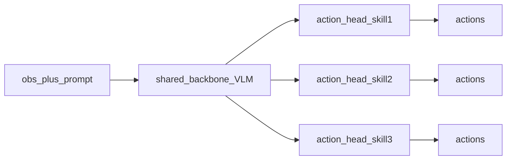

# 共用 VLM、只切 Action Expert：可行性与改造方案

## 结论：**可以改，且权重层面已经“合法”**

对三个 nortc ckpt（skill1/3852、skill2/10952、skill3/5336）做了 safetensors 逐 tensor 对比：

| 模块 | tensor 数 | 磁盘占比 | skill1 vs 2 vs 3 |
|------|-----------|----------|------------------|
| `backbone.*`（Cosmos VLM） | 494 | ~3.67GB | **完全一致**（`torch.equal` 全过） |
| `action_head.*`（DiT + encoder/decoder + vlln + vl_self_attention） | 537 | ~3.24GB | **全部不同** |

训练配置也吻合：`tune_llm=False`、`tune_visual=False`，backbone 冻结；`tune_projector/diffusion/vlln=True` 改的都在 `action_head` 里（这里的 projector 是 action/state MLP，不是另挂一份 VLM projector）。

因此：**不是**“一份 VLM 接多个训练期 MoE expert”，而是 **同一冻结 backbone 上挂多份独立微调的 action_head，运行时切换**——对你们现有分开微调的整模 ckpt 成立。



模型入口本身已拆开（[`gr00t_n1d7.py`](RL_controller/Deploy/Litchi-GR00T-WholeBodyControl/.deps/Isaac-GR00T/gr00t/model/gr00t_n1d7/gr00t_n1d7.py)）：

```python
backbone_outputs = self.backbone(backbone_inputs)
action_outputs = self.action_head.get_action(backbone_outputs, action_inputs, options)
```

具备“换 `self.action_head` 指针”的结构基础。

## 和当前双整模方案的对比

| | 现行：双完整 PolicyServer | 改造：共享 VLM + 多 action_head |
|--|---------------------------|--------------------------------|
| 进程 | 2× `run_gr00t_server` | **1** 个自定义 PolicyServer |
| 显存（估） | ~14GB（2×整模） | **~13GB（1×BB+3×AH）** 或 ~10GB（1×BB+2×AH） |
| 切技能延迟 | 温切换端口（秒级）+ 后台再热启动下一整模 | **模块指针切换（毫秒级）**，无需再加载 |
| 实现量 | 已有 supervisor | 需改加载/推理服务，不能只改 launch 脚本 |

**推荐默认：单进程常驻 `1×backbone + 3×action_head`。**  
32GB 显存够用；三个 skill 都已在 GPU 上，键盘 `1/2/3` 只换 head + prompt，可删掉双端口 prefetch/promote 复杂度。

## 不能直接“两行配置”完成的原因

- 现网是两个独立 `--model-path` 进程，各自完整 `from_pretrained`，**不会自动共享** CUDA 上的 backbone。
- 官方 [`PolicyServer` / `Gr00tPolicy`](RL_controller/Deploy/Litchi-GR00T-WholeBodyControl/.deps/Isaac-GR00T/gr00t/policy/gr00t_policy.py) 没有 “multi action_head registry”。
- 需要自定义服务：从 skill1 加载整模 → 抽出/保留 `backbone` → 再从 skill2/3 **只加载 `action_head.*` 权重**装进额外 `Gr00tN1d7ActionHead`。

## 建议实现路径（确认后落地）

1. **新建** `gear_sonic/scripts/run_shared_vlm_skill_server.py`（或薄封装 Isaac-GR00T PolicyServer）  
   - 加载 base ckpt（skill1）得到 `model.backbone` + `action_heads["1"]`  
   - 对 skill2/3：`load_state_dict` 过滤 `action_head.` 前缀，构造并 `.cuda()` 另外两份 head  
   - ZMQ `get_action`：用当前 `active_skill_id` 选 head；控制口 `switch` 只改 id + `reset` 状态  
   - 对外仍只绑 **一个** policy 端口（如 5550）；5590 控制协议可保留，回复里 `warm=True` 恒成立

2. **改** [`run_vla_inference.py`](RL_controller/Deploy/Litchi-GR00T-WholeBodyControl/gear_sonic/scripts/run_vla_inference.py)  
   - 切技能后 **不必** 换 `policy_port`（单端口）；仍做 hard restart + prompt 更新 + `PolicyClient.reset()`

3. **改/替** [`launch_multi_skill_nortc.sh`](RL_controller/Deploy/Litchi-GR00T-WholeBodyControl/gear_sonic/scripts/launch_multi_skill_nortc.sh) 与文档 [`multi_skill_nortc_dual_buffer_deploy.md`](RL_controller/Deploy/Litchi-GR00T-WholeBodyControl/docs/notes/g1/multi_skill_nortc_dual_buffer_deploy.md)：双整模 supervisor → 共享 VLM 单 server

4. **校验**  
   - 启动后 `nvidia-smi` ≈ 一份 backbone + 三份 head  
   - 同观测下，共享服务 skillK 的 action 与「单独整模 server skillK」数值对齐（或最大误差在 bf16 容差内）  
   - 键盘 `1→2→3` 切换无加载等待

## 风险（可控）

- **必须整包切换 `action_head`**（含 DiT、`vlln`、`vl_self_attention`、action/state encoder），不能只换 diffusion 子模块。  
- Processor / embodiment 三份需一致（当前同 tag `UNITREE_G1_SONIC`，预期 OK）。  
- `PolicyClient` 侧历史（prev action / RTC 缓存）切换时仍要 `reset`；与现在 hard restart 一致。  
- 若未来某 skill 解冻了 backbone，共享前提立刻失效——部署前应对齐 `backbone.*` 是否仍 identical。
